<div align="center">


# SkyVault

**Encrypted SSH vault, tunnel manager and ssh-agent for Windows**

*Keep SSH keys, servers and passwords behind one master password. Open terminals in one click, forward remote ports with a picker that reads what the server is actually listening on, and let `ssh` and `git` use your keys without the private keys ever touching the disk.*

---

[](https://tauri.app/)
[](https://www.rust-lang.org/)
[](https://react.dev/)
[](https://www.typescriptlang.org/)
[](#requirements)
[](#license)
[](https://github.com/SkyFetch0/skyvault/releases/latest)

---


-B7410E?logo=gnubash&logoColor=white)


**[Download](#download)** · **[Screenshots](#screenshots)** · **[Features](#features)** · **[Security model](#security-model)** · **[Getting started](#getting-started)** · **[Usage notes](#usage-notes)** · **[Project layout](#project-layout)** · **[Roadmap](#roadmap)**

</div>

---

## Screenshots

All data in these pictures is made up: the addresses come from the documentation ranges (RFC 5737), and the keys and passwords were created for the demo.

<p align="center">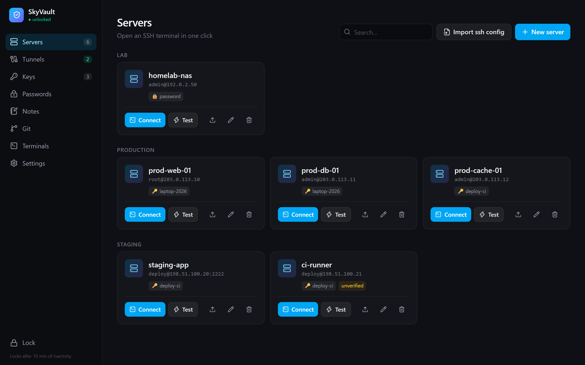</p>

<p align="center">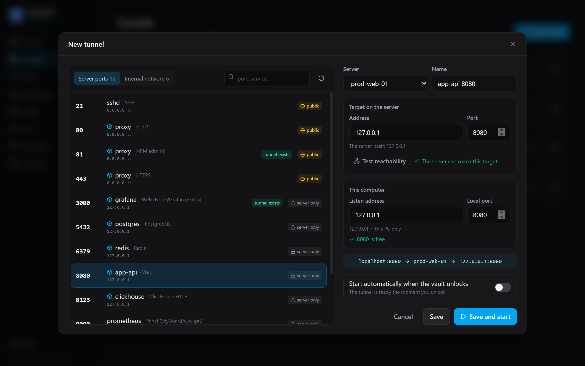</p>

| | |
|---|---|
| 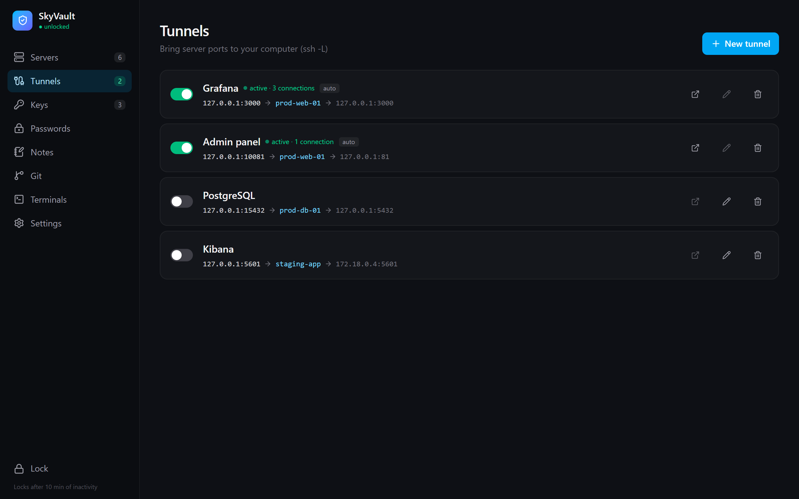 **Tunnels** — local port → server → target, live connection count | 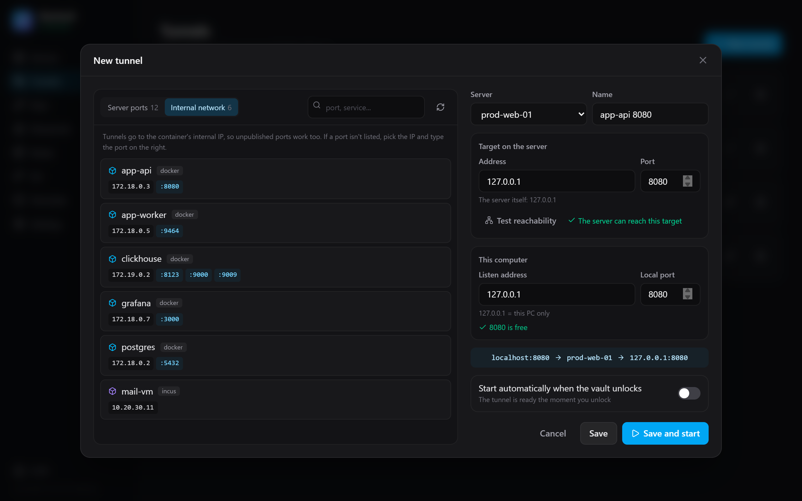 **Internal network** — reach container ports that are not published |
| 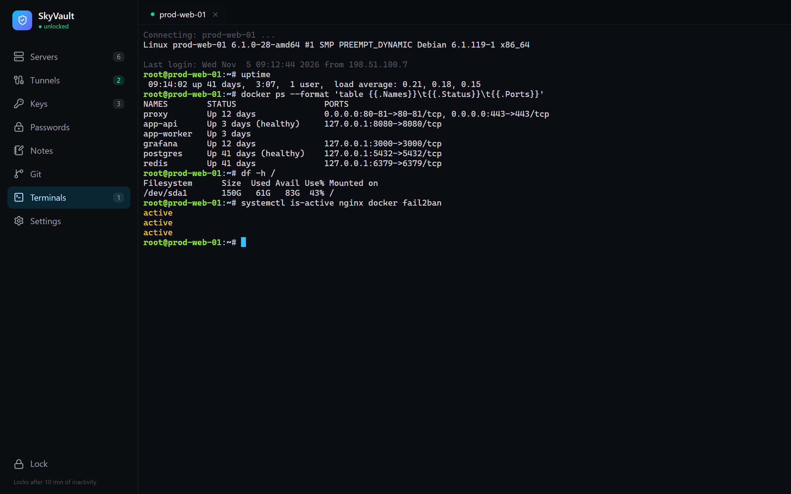 **Terminal** — one click from the server card, tabs stay alive | 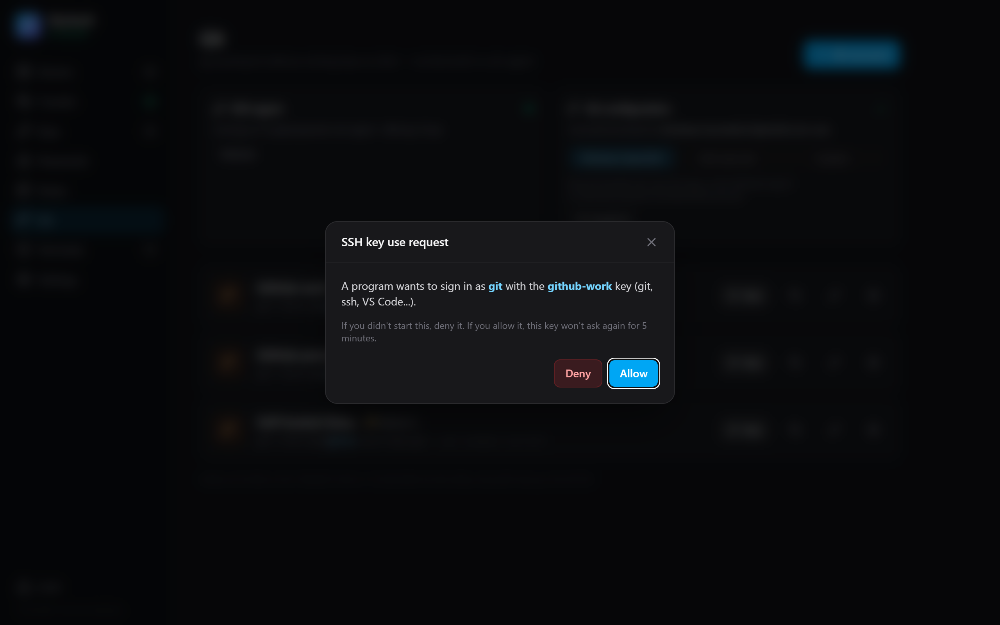 **ssh-agent approval** — every signature is confirmed |
| 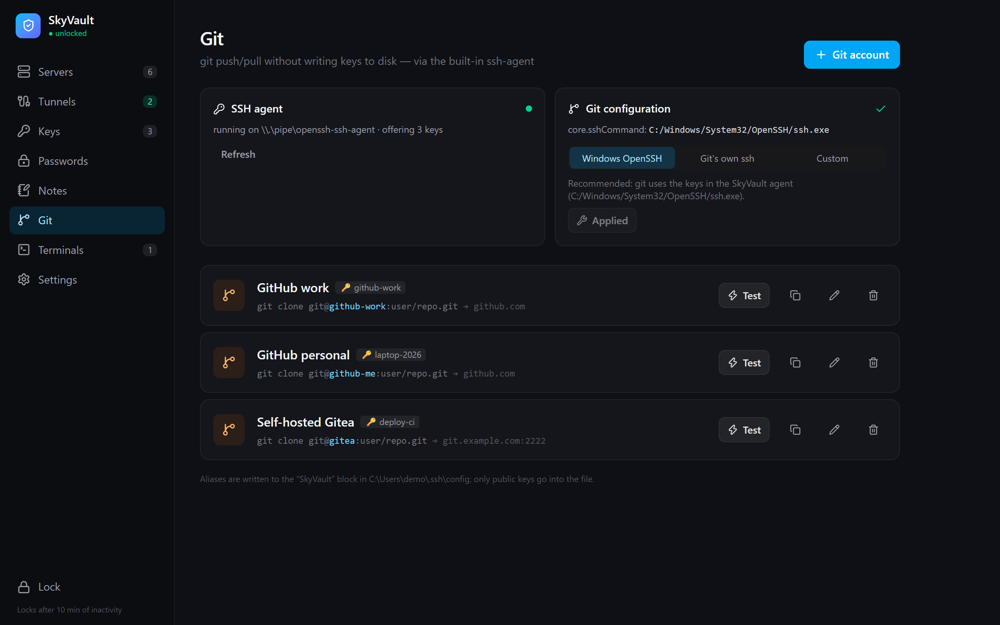 **Git** — host aliases per account, `core.sshCommand` from the app | 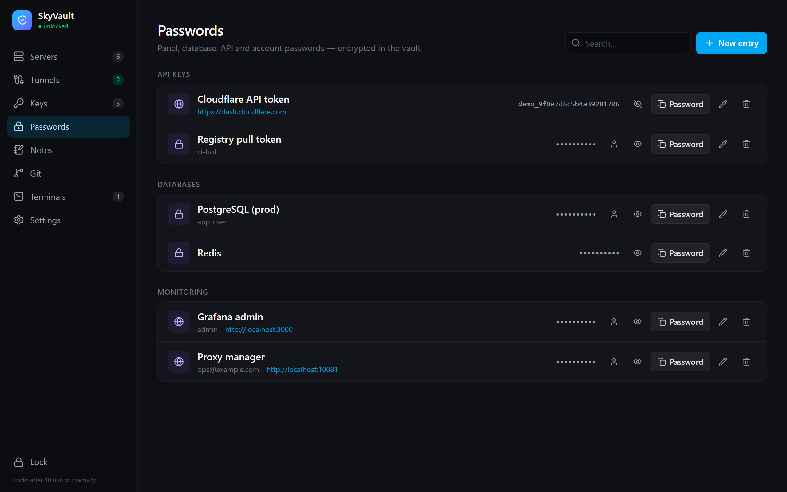 **Passwords** — copied through Rust, wiped from the clipboard |
| 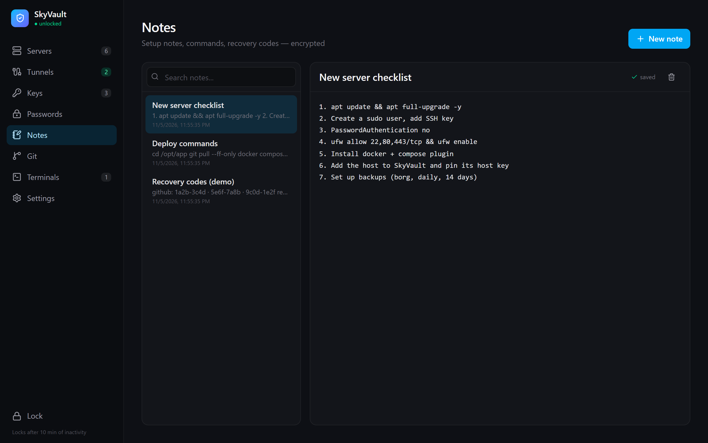 **Notes** — encrypted, saved as you type | 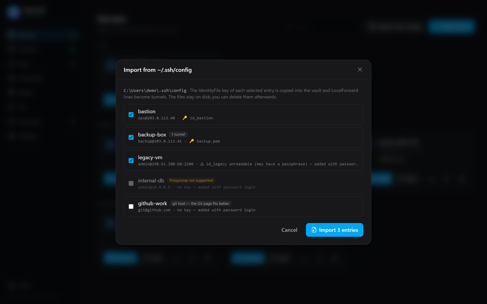 **ssh config import** — hosts, keys and LocalForwards in one step |
| 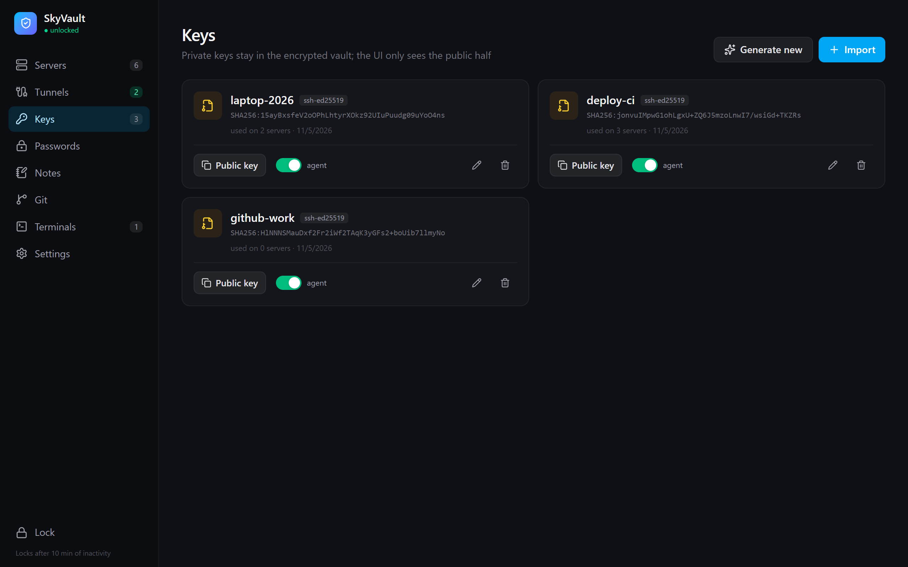 **Keys** — OpenSSH, PEM, PKCS#8, PuTTY; per-key agent switch | 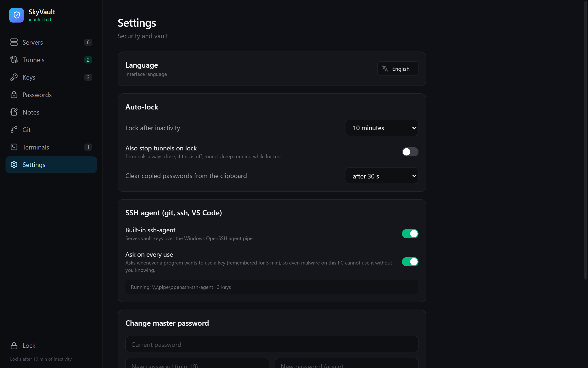 **Settings** — language, auto-lock, clipboard, agent |

<p align="center">
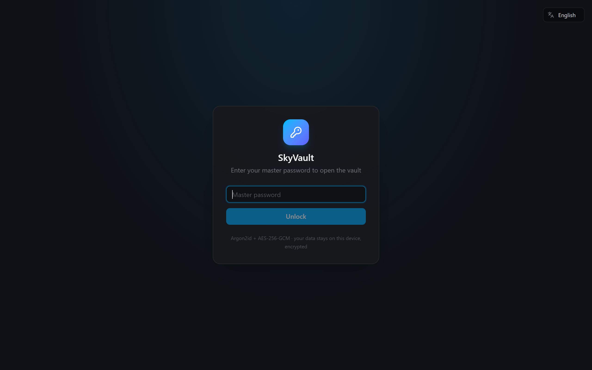
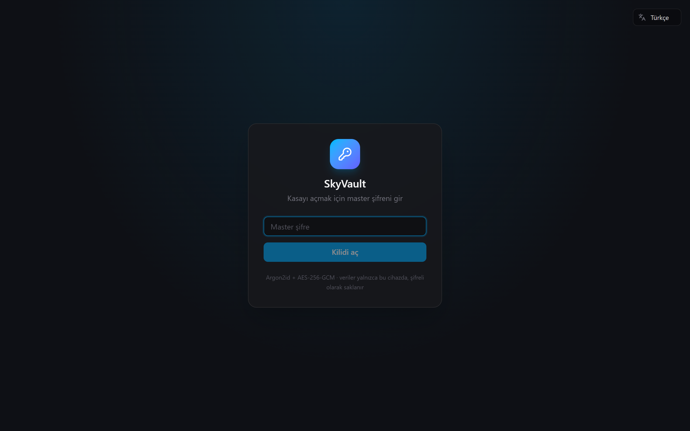
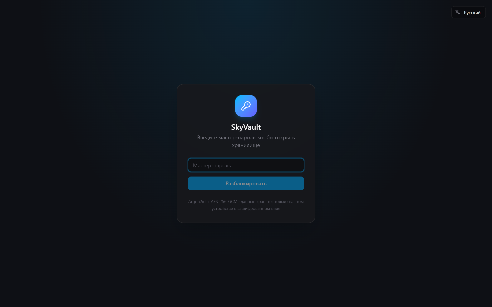
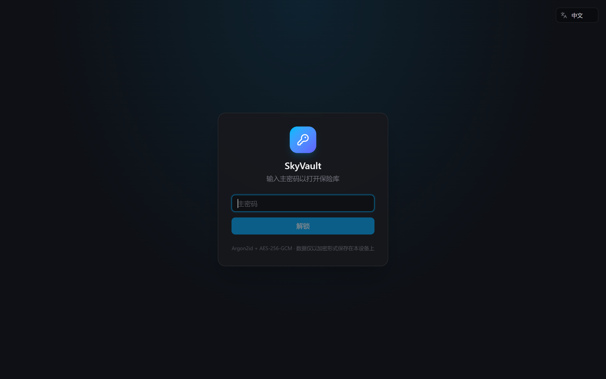
</p>
<p align="center"><sub>The lock screen in English, Turkish, Russian and Chinese</sub></p>

---

## Features

- **Encrypted vault:** servers, keys, passwords and notes live in one file that cannot be read without the master password. Locks itself after a period of inactivity.
- **Servers and terminal:**
  - Key or password authentication; password logins fall back to `keyboard-interactive` when plain password auth is disabled.
  - One-click xterm.js terminal.
  - `ssh-copy-id`-style public key upload.
- **Keys:** import OpenSSH, PEM (RSA / EC, including passphrase-protected), PKCS#8 and PuTTY `.ppk`, or generate new Ed25519 keys.
- **Port tunnels (`ssh -L`):**
  - **Port picker:** lists the ports the server is listening on, labelled with the Docker container that publishes them and whether they are public or local-only.
  - **Internal network:** lists Docker and Incus containers with their internal IPs and ports, so you can reach services that are not published at all.
  - **Manual entry:** type any target and use *Test reachability* to check it from the server.
  - **Local port:** suggests a free local port when the requested one is taken.
- **Built-in ssh-agent:**
  - Serves vault keys to `ssh`, `git` and VS Code on the standard Windows OpenSSH agent pipe.
  - Asks for approval on every use (remembered for 5 minutes).
  - If a request arrives while the vault is locked, it waits for you to unlock.
- **Git:**
  - Per-account host aliases (`git clone git@github-work:user/repo.git`); only public keys are written to disk.
  - `core.sshCommand` is configurable from the app.
- **Passwords and notes:** password generator; copied secrets are cleared from the clipboard after a configurable delay.
- **`~/.ssh/config` import:** brings existing `Host` entries, their `IdentityFile` keys and `LocalForward` lines into the vault in one step.
- **Four languages:** English, Türkçe, Русский and 中文, switchable from the lock screen or Settings.
- **Tray:** closing the window keeps the app in the system tray.

## Security model

- **Vault file:** `%APPDATA%\net.skyfetch.skyvault\vault.skv`
  - Encrypted with Argon2id (64 MiB, t=3, p=1) + AES-256-GCM. The KDF parameters are bound to the ciphertext as AAD.
  - Every save uses a fresh nonce and an atomic write, and keeps the previous version as `.bak`.
- **Where secrets live:**
  - Private keys and passwords stay in the Rust process; the webview only ever sees public keys and fingerprints.
  - Keys are never written to temporary files.
  - Secrets are wiped from memory on lock (`zeroize`).
- **Host keys:** trust on first use with explicit fingerprint confirmation, and a MITM warning if a server's key changes.
- **ssh-agent:**
  - Only supports listing identities and signing; keys cannot be added from outside the vault.
  - Every signature needs user approval, so other software on the machine cannot use your keys silently.
- **Webview hardening:** strict CSP; Tauri capabilities kept to the minimum (`src-tauri/capabilities/default.json`).

## Download

Get the latest build from **[Releases](https://github.com/SkyFetch0/skyvault/releases/latest)**:

| File | What it is |
| --- | --- |
| `SkyVault_<version>_x64-setup.exe` | Installer (per user, no admin rights needed), adds a Start menu entry |
| `SkyVault_<version>_x64_portable.exe` | Single executable, no installation — run it from anywhere, e.g. a USB drive |

Requires Windows 10/11 with WebView2 (included in Windows 11). The builds are not code-signed yet, so Windows SmartScreen may warn on first launch: choose *More info → Run anyway*. Each release lists SHA-256 checksums so you can verify the download.

## Getting started

### Requirements

- Windows 10/11 (WebView2 ships with Windows 11)
- [Node.js](https://nodejs.org/) 20+
- [Rust](https://rustup.rs/) stable (MSVC toolchain) with Visual Studio Build Tools (C++)

### Run in development

```bash
npm install
npm run tauri dev
```

### Build

```bash
npx tauri build --no-bundle
```

This produces `src-tauri/target/release/skyvault.exe`, a single portable executable. Run `npx tauri build` without `--no-bundle` to also get an NSIS installer.

### Tests

The tests cover:
- vault encryption
- connect / host key / tunnel / keyboard-interactive flows against an in-process SSH server
- the ssh-agent protocol
- key formats produced by `ssh-keygen`
- the port and ssh-config parsers

```bash
cd src-tauri
cargo test --lib
```

### Environment variables

| Variable | Effect |
| --- | --- |
| `SKYVAULT_VAULT` | Use a different vault file (e.g. on a USB drive) |
| `SKYVAULT_SSH_DIR` | Directory used instead of `~/.ssh` (git aliases, ssh-config import) |

## Usage notes

### Tunnels
- The port list does not scan anything. SkyVault runs `ss -tlnp` (falling back to `netstat`), `docker ps` and `incus list` on the server and parses their output.
- *Test reachability* opens a direct-tcpip channel from the server to the target, which is exactly what the tunnel will do.
- When the requested local port is busy:
  - ports below 1024 move into the 10000 range (81 → 10081)
  - other ports get +10000 (9090 → 19090)

### Git
Git for Windows ships its own ssh, which cannot reach the agent. The *Git configuration* card on the Git page sets the global `core.sshCommand`:
- **Windows OpenSSH** (recommended): git uses the SkyVault agent.
- **Git's own ssh:** the setting is removed.
- **Custom command:** any ssh client you prefer.

Aliases are written to a managed block in `~/.ssh/config`. Everything outside that block is left alone, and the original file is backed up once as `config.skyvault.bak`.

### ssh-agent
- The agent listens on `\\.\pipe\openssh-ssh-agent`. If the Windows ssh-agent service already owns that pipe, it uses `\\.\pipe\skyvault-agent` instead.
- The agent only runs while the app is open.

### Translations
All UI text lives in [`src/i18n.tsx`](src/i18n.tsx), with each entry holding its English, Turkish, Russian and Chinese text side by side, so a missing translation is a type error. Messages from the Rust core are sent as codes (`msg!()` in `src-tauri/src/lib.rs`) and translated by the UI.

## Project layout

```
src/                  React UI
  App.tsx             shell, navigation, host-key and agent approval dialogs
  Views.tsx           servers, tunnel list, keys, settings
  Views2.tsx          passwords, notes, git
  Tunnels.tsx         tunnel form with port picker, ssh-config import
  Terminal.tsx        xterm.js terminal
  i18n.tsx            translations (en / tr / ru / zh) and language picker
  api.ts              typed wrappers for the Tauri commands
src-tauri/src/        Rust core
  vault.rs            Argon2id + AES-256-GCM vault
  ssh.rs              connections, terminals, tunnels (russh)
  agent.rs            ssh-agent on a Windows named pipe
  git.rs              managed ~/.ssh/config block, core.sshCommand
  ports.rs            parsing of the server's listening ports
  sshconfig.rs        ~/.ssh/config reader
  features.rs         passwords, notes, git, tunnel helpers, import
  lib.rs              app state, commands, tray, auto-lock
```

## Roadmap

- [x] Vault, servers, keys, terminal, local port forwarding, tray, auto-lock
- [x] ssh-agent, git aliases, passwords, notes
- [x] Port picker, internal network targets, `~/.ssh/config` import
- [x] English, Turkish, Russian and Chinese UI
- [ ] Jump hosts (ProxyJump), SOCKS (`-D`) and remote (`-R`) forwarding
- [ ] Public key upload via the GitHub API, Windows Hello unlock
- [ ] Android app and encrypted vault sync
- [ ] FIDO2 / YubiKey (`ed25519-sk`) keys

## License

MIT © SkyVault contributors

---

<div align="center">
<sub>Built with Rust and Tauri · Runs on Windows</sub>
</div>
